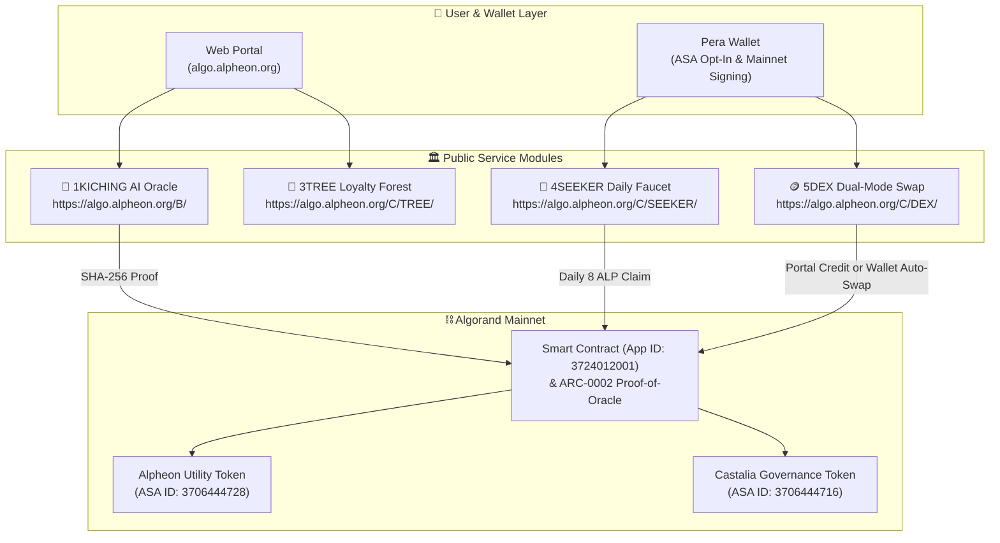

# 🏛️ CASTALIEN Protocol (`algo.alpheon.org`)
### AI Philosophical Oracle & Web2.5 Loyalty Ecosystem on Algorand

[](https://algo.alpheon.org/)
[-6C5CE7?style=for-the-badge)](https://explorer.perawallet.app/asset/3706444728)
[-FDCB6E?style=for-the-badge)](https://explorer.perawallet.app/asset/3706444716)
[](https://explorer.perawallet.app/application/3724012001)
[](https://github.com/alpheonadmin-cyber/castalien-algorand-protocol/actions)

> **Official Web3 Ecosystem Portal:** [https://algo.alpheon.org/](https://algo.alpheon.org/)  
> **Root Philosophy Portal:** [https://alpheon.org/](https://alpheon.org/)  
> **Litepaper:** [📄 Read the Official English Litepaper (`docs/LITEPAPER.md`)](./docs/LITEPAPER.md)

---

## 🌐 Overview

**CASTALIEN (`algo.alpheon.org`)** is a live **AI + Web3 Consumer Application** built on the **Algorand Mainnet**. Inspired by Hermann Hesse’s *The Glass Bead Game (Das Glasperlenspiel)*, CASTALIEN bridges classical Eastern wisdom (`1KICHING` & `Saju`) with modern generative AI and **Algorand on-chain asset primitives**.

Our mission is to onboard mainstream Web2 users into the Algorand ecosystem with zero friction: users experience AI philosophical consultations and seamlessly transition into active **Pera Wallet** holders through daily on-chain **Alpheon (`ALP`)** faucets, cryptographic **Proof-of-Oracle** report notarization, and Dual-Mode Mainnet token swaps (`5DEX`).

---

## ⛓️ Live Algorand Mainnet Deployments

All public assets and smart contracts are deployed and active on **Algorand Mainnet**:

| Component | Identifier / Address | Role & Specification | Explorer Link |
| :--- | :--- | :--- | :--- |
| **Alpheon (`ALP`)** | **ASA ID: `3706444728`** | Primary Ecosystem Utility Token (`1,000,000,000 ALP`, Decimals: `0`) | [Pera Explorer](https://explorer.perawallet.app/asset/3706444728) |
| **Castalia (`CST`)** | **ASA ID: `3706444716`** | Master Governance & Monastery Token (`1,000,000 CST`, Decimals: `0`) | [Pera Explorer](https://explorer.perawallet.app/asset/3706444716) |
| **Protocol Smart Contract** | **App ID: `3724012001`** | Mainnet Treasury, Atomic Swap & Oracle Notary App | [Pera Explorer](https://explorer.perawallet.app/application/3724012001) |
| **Creator / Manager** | `WAURKB4IAMDX2HI5ZJK5YP5CXZF43XPLOZSROWWYLD5ZJM3H3FSPCAH6CA` | Official Asset Creator & Configuration Authority | [Pera Explorer](https://explorer.perawallet.app/address/WAURKB4IAMDX2HI5ZJK5YP5CXZF43XPLOZSROWWYLD5ZJM3H3FSPCAH6CA) |
| **Treasury / Reserve** | `FGRDXIENOISLCFTP2FRHXH25OJTZNANSXCVTKEFJRWR3NCXPO4PDJTWET4` | 5DEX Liquidity Reserve & 4SEEKER Daily Faucet Vault | [Pera Explorer](https://explorer.perawallet.app/address/FGRDXIENOISLCFTP2FRHXH25OJTZNANSXCVTKEFJRWR3NCXPO4PDJTWET4) |
| **Live Proof-of-Oracle TX** | `FBI5FHWNRAC3QEKAUVQXHZELMGCS6HQVVYFIJ4CXSPXW5FDVUX2Q` | Verified Mainnet AI Report SHA-256 Notarization TX | [Pera Explorer](https://explorer.perawallet.app/tx/FBI5FHWNRAC3QEKAUVQXHZELMGCS6HQVVYFIJ4CXSPXW5FDVUX2Q) |

---

## 🏗️ High-Level Algorand Integration Architecture



---

## 📂 Repository Structure (AlgoKit 2.0 Compliant)

> **Note:** This public repository contains ONLY the open-source Algorand smart contract interface, compiled TEAL/ARC-32 artifacts, ASA verification metadata, and client-side `ARC-0002` / `5DEX` verification SDK. Proprietary AI inference pipelines and internal backend services are maintained in private repositories.

```text
castalien-algorand-protocol/
├── .algokit.toml                                  # AlgoKit v2 workspace configuration
├── .github/workflows/ci.yml                       # Automated GitHub Actions pytest workflow
├── pyproject.toml                                 # Python 3.12 dependencies (algokit, algopy, py-algorand-sdk)
├── README.md                                      # Project overview & Mainnet deployment registry
├── SECURITY.md                                    # Public security & key isolation policy
├── docs/
│   └── LITEPAPER.md                               # Public English Litepaper & Tokenomics
├── assets/
│   ├── asa-3706444728-alpheon.json                # ARC-69 / Pera Verification Metadata for Alpheon (ALP)
│   ├── asa-3706444716-castalia.json               # ARC-69 / Pera Verification Metadata for Castalia (CST)
│   ├── alpheon-logo.svg                           # Official 256x256 Vector Token Icon (ALP)
│   └── castalia-logo.svg                          # Official 256x256 Vector Token Icon (CST)
├── smart_contracts/
│   ├── castalien_protocol/
│   │   ├── contract.py                            # Algorand Python (ARC-4 / Puya) Smart Contract Interface
│   │   └── deploy_config.py                       # AlgoKit deployment configuration
│   └── artifacts/castalien_protocol/              # Compiled TEAL & ARC-32 Application Spec Artifacts
│       ├── CastalienProtocol.approval.teal
│       ├── CastalienProtocol.clear.teal
│       └── CastalienProtocol.arc32.json
├── sdk/
│   ├── oracle_notary.py                           # Proof-of-Oracle SHA-256 On-Chain Notary SDK
│   └── algorand_verifier.py                       # Algonode Mainnet Opt-In, TXID & 5DEX Quote SDK
└── tests/
    └── test_oracle_notary.py                      # Public SDK & Tokenomics Unit Tests
```

---

## 🚀 Quickstart (AlgoKit & Python SDK)

### 1. Prerequisites
- **Python 3.12+**
- **[AlgoKit CLI 2.0+](https://developer.algorand.org/algokit/)**

### 2. Installation
```bash
git clone https://github.com/alpheonadmin-cyber/castalien-algorand-protocol.git
cd castalien-algorand-protocol
cp .env.example .env
pip install -e .
```

### 3. Run Unit Tests
```bash
pytest
```

### 4. Verify an Account, Compute a 5DEX Quote & Build an Oracle Proof
```python
from sdk.algorand_verifier import calculate_dex_swap_quote, check_mainnet_account_status
from sdk.oracle_notary import build_oracle_proof_payload

# 1. Check Pera Wallet Opt-In status for Alpheon (3706444728) & Castalia (3706444716)
status = check_mainnet_account_status("FGRDXIENOISLCFTP2FRHXH25OJTZNANSXCVTKEFJRWR3NCXPO4PDJTWET4")
print("Mainnet Status:", status)

# 2. Calculate a 5DEX Dual-Mode Swap Quote (1 ALGO = 1,024 ALP = 10,240 EON)
quote = calculate_dex_swap_quote("ALGO", 1.0, settlement_mode="AUTO_SWAP_ALP")
print("5DEX Swap Quote:", quote)

# 3. Create an ARC-2 compliant Proof-of-Oracle payload for an AI reading
proof = build_oracle_proof_payload(
    report_uuid="RPT-20261023-0001",
    service_type="ORACLE_ICHING",
    hexagram_binary="111101",
    report_markdown="# Sample Report Content"
)
print("ARC-2 Note Payload:", proof)
```

---

## 📬 Official Links & Contact

- **Web3 Ecosystem Portal:** [https://algo.alpheon.org/](https://algo.alpheon.org/)
- **AI Oracle (`1KICHING`):** [https://algo.alpheon.org/B/](https://algo.alpheon.org/B/)
- **Loyalty Forest (`3TREE`):** [https://algo.alpheon.org/C/TREE/](https://algo.alpheon.org/C/TREE/)
- **Digital Forest (`4SEEKER`):** [https://algo.alpheon.org/C/SEEKER/](https://algo.alpheon.org/C/SEEKER/)
- **Swap Exchange (`5DEX`):** [https://algo.alpheon.org/C/DEX/](https://algo.alpheon.org/C/DEX/)
- **Contact:** `admin@alpheon.org`
