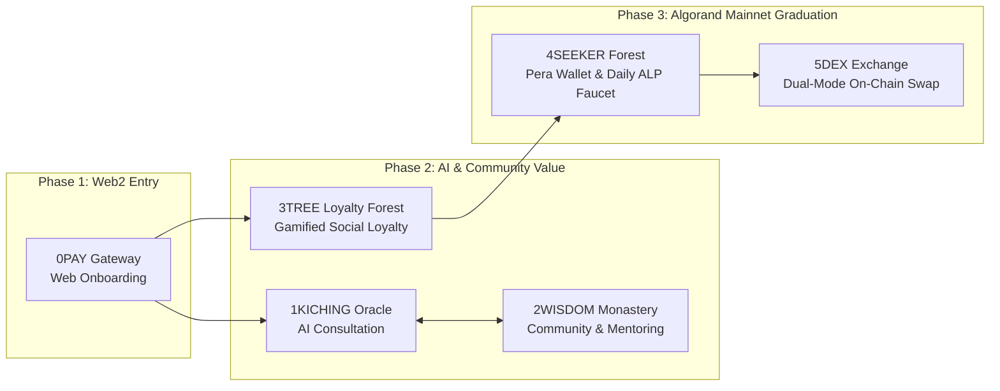

# 📜 CASTALIEN Protocol: Official English Litepaper
### Bridging AI Philosophical Consultation, Gamified Loyalty, and Algorand On-Chain Primitives

- **Version:** 1.0 (October 2026)
- **Ecosystem Portal:** [https://algo.alpheon.org/](https://algo.alpheon.org/)
- **GitHub Repository:** [https://github.com/alpheonadmin-cyber/castalien-algorand-protocol](https://github.com/alpheonadmin-cyber/castalien-algorand-protocol)
- **Network:** Algorand Mainnet
- **On-Chain Assets:** `Alpheon (ALP, ASA 3706444728)` · `Castalia (CST, ASA 3706444716)` · `Mainnet App ID: 3724012001`

---

## 1. Executive Summary

While Web3 infrastructure has achieved high throughput and low transaction finality—exemplified by **Algorand’s instant finality and sub-cent fees**—mainstream consumer adoption remains bottlenecked by two critical challenges:
1. **Lack of Everyday Consumer Utility:** Many decentralized applications focus exclusively on financial speculation rather than recurring cultural, educational, or lifestyle value.
2. **Onboarding Friction:** Expecting non-crypto users to purchase `ALGO` on an exchange, install a self-custody wallet, understand Minimum Balance Requirements (`MBR`), and execute ASA Opt-In transactions before experiencing a product creates a steep barrier to entry.

**CASTALIEN (`algo.alpheon.org`)** addresses both challenges through a **Progressive Web2.5-to-Web3 Funnel**:
- **Consumer AI Utility (`1KICHING` & `Saju`):** Users engage with an AI consultation platform rooted in classical Eastern philosophy, generating structured analytical reports and interactive sessions.
- **Zero-Friction Entry, Organic Pera Wallet Graduation:** Users start immediately via standard web authentication and in-app utility points (`EON`), then naturally connect a **Pera Wallet** to claim daily on-chain **Alpheon (`ALP`)** attendance rewards (`4SEEKER`), verify their AI readings on Algorand (`Proof-of-Oracle`), and swap earned loyalty rewards on-chain (`5DEX`).

---

## 2. Core Ecosystem Overview



### 2.1 `1KICHING` & `Saju` (AI Philosophical Oracle)
- Provides interactive AI consultations based on the I-Ching and traditional Eastern calendar principles.
- Each completed consultation report is cryptographically hashed (`SHA-256`) and notarized on **Algorand Mainnet** (`Proof-of-Oracle`), allowing users to independently verify report integrity via Pera Explorer.

### 2.2 `2WISDOM` & `3TREE` (Community & Gamified Loyalty Forest)
- **`2WISDOM`:** A community knowledge and mentoring hub connecting users with experienced mentors (**Maesters**).
- **`3TREE`:** A gamified social loyalty program where community participation and tree cultivation unlock ecosystem rewards and consultation benefits in a sustainable closed loop.

### 2.3 `4SEEKER` (On-Chain Pera Wallet Onboarding)
- Guides users through connecting their **Pera Wallet**, checking Algorand Mainnet account status (`ALGO` balance, ASA Minimum Balance Requirement, and Opt-In state for `ASA 3706444728` and `ASA 3706444716`).
- **Daily 8 ALP On-Chain Faucet:** Verified Pera Wallet holders can claim **8 ALP** daily on-chain, driving consistent daily active wallet engagement on Algorand Mainnet.

### 2.4 `5DEX` (Dual-Mode On-Chain Token Swap Portal)
- Bridges in-app utility points (`EON`) and on-chain Algorand Standard Assets (`ALP`, `CST`, `ALGO`) through two seamless settlement modes:
  1. **Portal TXID Verification Mode:** Authenticated web users transfer `ALGO` or `ALP` to the Treasury and submit the Mainnet `TXID` on the `5DEX` portal to receive instant in-app `EON` utility balance (`1 ALGO = 10,240 EON`, `1 ALP = 10 EON`).
  2. **Direct Wallet-to-Wallet Auto-Swap Mode:** External Algorand wallets that send `ALGO` directly to the Treasury without a portal session automatically receive **`Alpheon (ALP)` (`1 ALGO = 1,024 ALP`)** back to the sender’s Algorand wallet on-chain.

---

## 3. Tokenomics & Equivalence Model

CASTALIEN separates in-app consumption points (`EON`) from on-chain Algorand Standard Assets (`ALP`, `CST`) to ensure zero gas friction for Web2 users while maintaining transparent on-chain supply on Algorand Mainnet.

### 3.1 On-Chain Algorand Standard Assets (ASA)

| Property | **Alpheon (`ALP`)** | **Castalia (`CST`)** |
| :--- | :--- | :--- |
| **Algorand Mainnet ASA ID** | **`3706444728`** | **`3706444716`** |
| **Token Role** | Ecosystem Utility & Reward Token | Master Governance & Monastery Token |
| **Total Supply** | `1,000,000,000 ALP` | `1,000,000 CST` |
| **Decimals** | `0` (Integer unit precision) | `0` (Integer unit precision) |
| **Creation TXID** | `6QSRL742ZIMNOPX23LHH6XEPPEOBZVFIKAQSXZMDPID7GZZ7F2NA` | `EXC3TQNSKVDN5NPX2T32VSMQYFKYESITEF6IL74ROVKVGODFXJTQ` |

### 3.2 Public Exchange & Equivalence Ratios

$$\mathbf{1\text{ ALGO} = 1,024\text{ ALP} = 10,240\text{ EON}}$$

$$\mathbf{1\text{ Castalia (CST)} = 1,000\text{ ALP} = 10,000\text{ EON}}$$

$$\mathbf{1\text{ Alpheon (ALP)} = 10\text{ EON}}$$

---

## 4. Algorand Technical Integration (`Proof-of-Oracle`)

Whenever a user generates an AI consultation report, the protocol computes a **SHA-256 cryptographic digest** of the report and anchors it on **Algorand Mainnet** via an `ARC-0002` formatted transaction note on **Alpheon (`ASA 3706444728`)**:

```text
castalien-oracle:v1:j{"p":"CASTALIEN_ORACLE","uuid":"RPT-20261023-0001","svc":"ICHING","hex":"111101","sha256":"e3b0c44298fc1c149afbf4c8996fb92427ae41e4649b934ca495991b7852b855","ts":1792728000,"asa":3706444728}
```

- **Live Mainnet Notarization Example TXID:** [`FBI5FHWNRAC3QEKAUVQXHZELMGCS6HQVVYFIJ4CXSPXW5FDVUX2Q`](https://explorer.perawallet.app/tx/FBI5FHWNRAC3QEKAUVQXHZELMGCS6HQVVYFIJ4CXSPXW5FDVUX2Q)

---

## 5. Alignment with Algorand Ecosystem Goals

1. **Mainstream Consumer AI Showcase:** Demonstrates how Algorand’s fast finality and low fees power real-time AI content notarization and micro-reward distribution.
2. **Active Wallet Growth Engine:** Converts non-crypto consumers into verified **Pera Wallet** holders through guided Opt-In UX and daily `8 ALP` on-chain rewards.
3. **Python & AlgoKit Native:** Built with **Python 3.12**, **AlgoKit 2.0**, **Algorand Python (`algopy`)**, and **`py-algorand-sdk`**.
